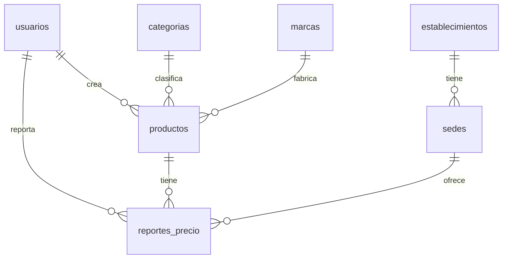

# Base de datos (Neon PostgreSQL)

El esquema se crea y versiona con **Flyway** (`src/main/resources/db/migration`). Al arrancar el backend se aplican
las migraciones pendientes; no hay que ejecutar SQL a mano.

| Migración | Contenido |
|---|---|
| `V1__esquema_inicial.sql` | Tablas, claves, restricciones, índices y la vista `v_precio_vigente` |
| `V2__funciones_registro.sql` | Funciones `obtener_o_crear_producto` y `registrar_precio` (atómicas, sin duplicados) |
| `V3__datos_base.sql` | Categorías y cadenas iniciales (sin productos ni precios de ejemplo) |

## Modelo



| Tabla | Descripción | Restricciones principales |
|---|---|---|
| `usuarios` | Quien reporta precios (nombre, correo) | correo único sin distinguir mayúsculas; formato de correo |
| `categorias`, `marcas`, `establecimientos` | Catálogos | nombre único sin distinguir mayúsculas (`lower(nombre)`) |
| `sedes` | Sucursal de un establecimiento en una ciudad | FK a `establecimientos`; única por (establecimiento, nombre, ciudad) |
| `productos` | Nombre, descripción, marca, categoría, presentación, cantidad, unidad, foto (BYTEA ≤ 1 MB) | FK a marca/categoría; `cantidad > 0`; unidad en `g, kg, ml, l, un`; **único** por (nombre, marca, presentación, cantidad, unidad) |
| `reportes_precio` | Cada precio reportado: producto, sede, usuario, `precio_cop`, `fecha_reporte` | `0 < precio_cop ≤ 100.000.000`; nunca se sobrescribe → **historial**; `ON DELETE CASCADE` desde producto |
| `v_precio_vigente` (vista) | Último reporte por (producto, sede) | `DISTINCT ON (producto_id, sede_id)` ordenado por fecha |

**Índices:** `ix_reportes_producto_sede_fecha (producto_id, sede_id, fecha_reporte DESC, id DESC)` (precio vigente e
historial), `ix_sedes_ciudad`, `ix_productos_marca`, `ix_productos_categoria`, `ix_reportes_sede`, `ix_reportes_usuario`
y los índices únicos de la tabla anterior.

**Reglas dentro de la base:** la fecha del reporte no puede ser futura (hora de Colombia) ni tener más de 2 años; los
errores usan `SQLSTATE 22023` (→ HTTP 400) y `P0002` (→ 404).

**Precio desactualizado:** se calcula al consultar (`dias = hoy_colombia() - fecha_reporte`) contra
`app.precios.dias-vigencia` (30 días por defecto, en `application.properties`).

## Consultas de ejemplo

```sql
-- 1) Precio vigente por sede de un producto, de menor a mayor, con diferencia contra el más barato
SELECT e.nombre AS almacen, s.nombre AS sede, s.ciudad, v.precio_cop, v.fecha_reporte,
       v.precio_cop - MIN(v.precio_cop) OVER () AS diferencia_cop
FROM v_precio_vigente v
JOIN sedes s ON s.id = v.sede_id
JOIN establecimientos e ON e.id = s.establecimiento_id
WHERE v.producto_id = 1
ORDER BY v.precio_cop;

-- 2) Historial de un producto con la variación frente al reporte anterior de la misma sede
SELECT r.fecha_reporte, s.nombre AS sede, r.precio_cop,
       r.precio_cop - LAG(r.precio_cop) OVER (PARTITION BY r.sede_id ORDER BY r.fecha_reporte, r.id) AS variacion
FROM reportes_precio r JOIN sedes s ON s.id = r.sede_id
WHERE r.producto_id = 1
ORDER BY r.fecha_reporte DESC, r.id DESC;

-- 3) Productos cuyo último precio tiene más de 30 días
SELECT p.id, p.nombre, MAX(v.fecha_reporte) AS ultimo_reporte
FROM productos p JOIN v_precio_vigente v ON v.producto_id = p.id
GROUP BY p.id, p.nombre
HAVING hoy_colombia() - MAX(v.fecha_reporte) > 30;

-- 4) Mayor ahorro potencial por producto (precio vigente más alto - más bajo)
SELECT p.nombre, MIN(v.precio_cop) AS minimo, MAX(v.precio_cop) AS maximo,
       MAX(v.precio_cop) - MIN(v.precio_cop) AS ahorro_cop
FROM productos p JOIN v_precio_vigente v ON v.producto_id = p.id
GROUP BY p.id, p.nombre
HAVING COUNT(*) > 1
ORDER BY ahorro_cop DESC;

-- 5) Precio promedio por categoría y ciudad
SELECT c.nombre AS categoria, s.ciudad, ROUND(AVG(v.precio_cop), 0) AS promedio
FROM v_precio_vigente v
JOIN productos p ON p.id = v.producto_id JOIN categorias c ON c.id = p.categoria_id
JOIN sedes s ON s.id = v.sede_id
GROUP BY c.nombre, s.ciudad ORDER BY c.nombre, s.ciudad;

-- 6) Registrar un precio manualmente (reutiliza producto, almacén y sede si existen)
SELECT * FROM obtener_o_crear_producto('Arroz blanco', NULL, 'Diana', 'Granos y cereales', 'Bolsa', 500, 'g', NULL, NULL, NULL);
SELECT registrar_precio(1, 'Jumbo', 'Jumbo Calle 80', 'Bogotá', NULL, 3200, NULL, NULL);
```

## Consultas de la API

Las consultas que usa el backend están en `src/main/resources/sql/*.sql` (parámetros `:nombre`):
`buscar_productos`, `comparar_precios`, `historial_producto`, `detalle_producto`, `foto_producto`, listas de apoyo,
`crear_usuario`, `registrar_producto` y `registrar_precio`.
